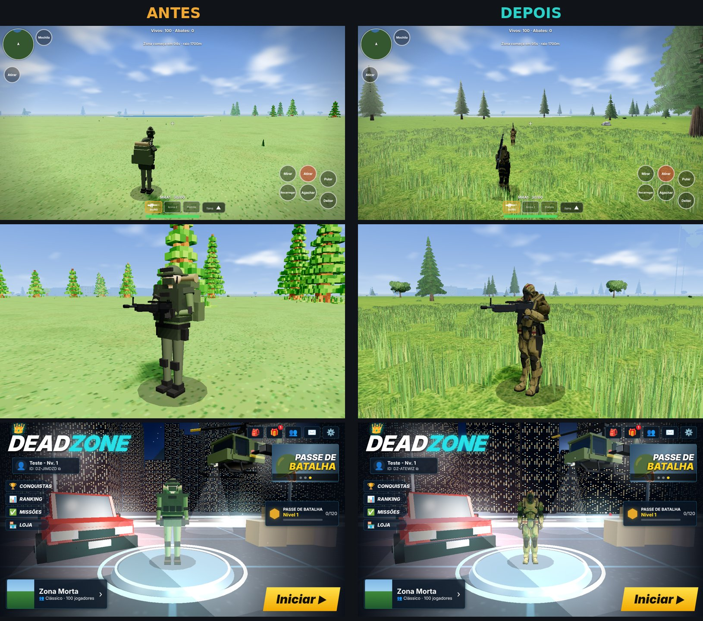

# Deadzone 3D

Battle royale 3D para celular e PC, feito com **Three.js**: 100 jogadores, salto de avião,
paraquedas, zona que fecha, veículos, helicópteros e modo online com amigos.

> **Fase atual (3.0): mapa em branco.** O mapa antigo (cidades, casas, estradas, árvores,
> ilha flutuante e loot) foi removido. O jogo agora usa uma ilha pequena e plana de
> 500 x 500 m (`src/js/world/map.js`), para o mapa ser construído do zero, peça por peça.



## Destaques

- **Personagens realistas**: soldado 3D com esqueleto, animações de captura de movimento
  (parado, andar, correr) misturadas às poses do jogo (mirar, agachar, deitar, paraquedas, morte)
  e mãos que seguram a arma com IK.
- **Terreno**: ilha de 500 x 500 m com montanha, morros, vale, praia e litoral irregular,
  solos misturados (grama, terra, rocha, areia) e dois heliportos. Ainda sem construções.
  O tamanho fica em `MAPH` (metade do lado) e a zona, a rota do avião e os mapas se ajustam sozinhos.
- **Avião de lançamento**: modelo 3D de um C-130 com as quatro hélices girando.
- **Veículos**: buggy (rodas que giram, suspensão e capotamento) e helicóptero, com combustível, dano e fogo.
- O código de armas e itens continua no projeto, mas nada aparece no chão do mapa por enquanto.
- **Modos**: Clássico (100 jogadores), Gladiadores 1v1/duo, Contra Squad 4v4 e salas
  personalizadas, com convite para amigos e grupo (party).
- **Lobby** com skins de roupa, paraquedas e veículo, conquistas, ranking, missões e loja.
- **Qualidade gráfica** ajustável (Baixa / Média / Alta) e controles editáveis.

## Jogar

| Onde | Como |
|---|---|
| Navegador | Abra o site do GitHub Pages do repositório (ver *Publicação*). |
| Android | Baixe o APK em **Releases** ou na aba **Actions → Build → Deadzone-APK**. |
| Arquivo único | `dist/Deadzone.html` (gerado pelo build) abre em qualquer navegador, até offline. |

**Controles no PC**: WASD anda · arrastar o mouse gira a câmera · espaço pula ·
C agacha · Z deita · Q mira · F atira · R recarrega · E pega item · V entra no veículo ·
G abre porta · I mochila · 1/2/3 trocam a arma.

## Desenvolvimento

Requisito: **Node.js 18+** (nenhuma dependência para instalar).

```bash
npm run dev            # servidor local em http://localhost:8080 (também aparece o endereço para o celular)
npm run build          # gera dist/web (site) e dist/Deadzone.html (arquivo único)
npm run build:android  # build + copia o jogo para o app Android
```

O jogo roda direto dos arquivos-fonte: edite um arquivo em `src/` e recarregue a página.

### APK Android

O APK é compilado automaticamente pelo GitHub Actions a cada envio para a `main`.
Para compilar no seu computador (precisa do Android Studio ou do Android SDK + Gradle 8.9+):

```bash
npm run build:android
cd android && gradle assembleDebug
# APK em android/app/build/outputs/apk/debug/app-debug.apk
```

## Estrutura

```
deadzone/
├── index.html              página do jogo (ordem de carregamento dos scripts)
├── manifest.webmanifest    instalação como app (PWA)
├── src/
│   ├── css/                estilos (interface, lobby, telas de fim, etc.)
│   └── js/
│       ├── core/           motor: renderizador, cena, áudio, laço principal
│       ├── graphics/       realismo: personagens, vegetação, relevo, vidros, ilha
│       ├── world/          mapa (map.js), terreno (terrain.js), avião e paraquedas
│       ├── player/         personagem, controles, ações e animações
│       ├── combat/         armas, tiros, loot, arremessáveis, arco, escopeta
│       ├── vehicles/       carros, helicópteros e direção
│       ├── bots/           inteligência e navegação dos bots
│       ├── game/           partida, zona, modos, progressão, espectador
│       ├── network/        online (MQTT): salas, gladiador, pareamento
│       ├── ui/             HUD, mapa, mochila, skins, configurações, lobby
│       ├── fx/             partículas e efeitos
│       └── features/       sistemas do lobby: conta, equipe, party, menus, telas
├── assets/
│   ├── models/             human.glb (personagem), animations.glb (captura de movimento), parachute.glb, vehicles/ (veículos)
│   ├── textures/           grama, tijolo, água
│   ├── images/             telas de carregamento, vitória e fim de partida
│   └── icons/              ícones do app
├── vendor/                 three.js r128, GLTFLoader, SkeletonUtils, mqtt.js
├── android/                app Android (WebView em tela cheia)
├── tools/                  build e servidor de desenvolvimento
├── docs/                   documentação técnica
└── .github/workflows/      build, APK, GitHub Pages e lançamentos
```

Detalhes técnicos em [docs/ARQUITETURA.md](docs/ARQUITETURA.md).

## Publicação

- **GitHub Pages**: em *Settings → Pages*, escolha **Source: GitHub Actions**. A cada envio para
  a `main` o site é publicado em `https://<usuário>.github.io/deadzone/`.
- **Lançamento com APK**: crie uma tag (`git tag v1.0.0 && git push --tags`) e o workflow
  *Lançamento* publica o APK e o arquivo único na página **Releases**.

© Deadzone 3D. Todos os direitos reservados ao autor.
